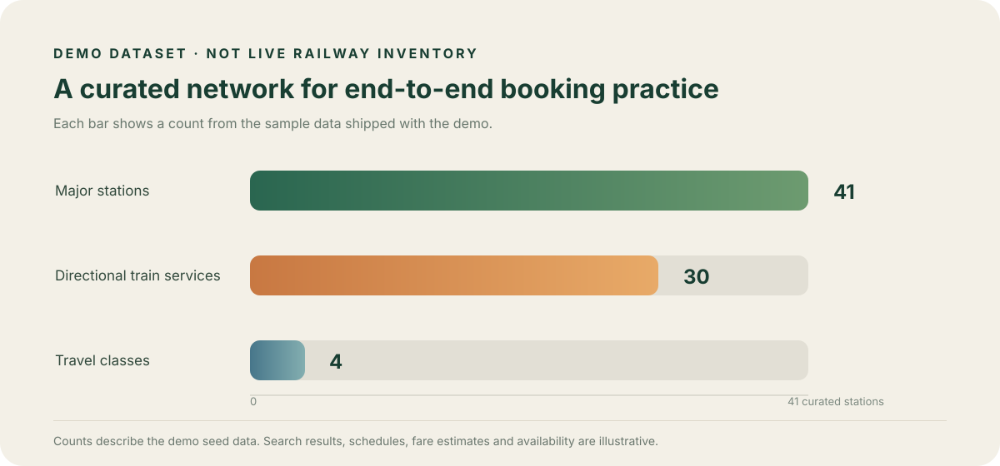
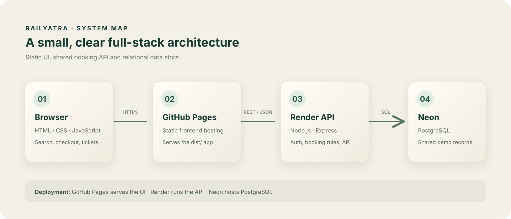

<div align="center">

# RailYatra

### Plan an India-wide rail journey in a polished, full-stack booking simulator.

A portfolio project for exploring the railway booking experience: accounts, route search, automatic seat allotment, simulated checkout, PNR lookup and downloadable demo tickets.

[**Full-stack app · recommended**](https://railyatra-api.onrender.com/) · [**Static frontend preview**](https://rachit1807.github.io/RailYatra/) · [API readiness](https://railyatra-api.onrender.com/api/ready) · [Source code](https://github.com/rachit1807/RailYatra)

[](https://github.com/rachit1807/RailYatra/actions/workflows/deploy-pages.yml)
[](https://github.com/rachit1807/RailYatra/actions/workflows/quality.yml)
[](https://railyatra-api.onrender.com/api/ready)


</div>

> **Demo only.** RailYatra is an independent learning project, not affiliated with IRCTC. It does not connect to live railway systems. Train numbers and official listing labels are cross-checked against an official enquiry snapshot; route stops and timings come from a public timetable reference snapshot and may be out of date. Seat availability, tracking, fares and payments are simulated; tickets are not valid for travel.

## Live preview

Choose the link that matches what you want to try:

| Link | What it runs | Best for |
|---|---|---|
| [**Render — full-stack RailYatra app**](https://railyatra-api.onrender.com/) | The frontend and Express API run together; shared demo accounts, bookings and transactions are stored in PostgreSQL on Neon. | The complete sign-in, booking, simulated payment, cancellation and ticket-download flow. Choose **Explore with a demo account** to start. This is the recommended link for using or presenting the project. |
| [**GitHub Pages — static frontend preview**](https://rachit1807.github.io/RailYatra/) | GitHub Pages serves the static frontend. It sends API requests to the Render service, so it depends on Render being available. | Previewing the interface. Because the frontend and API are on different sites, browser privacy settings may block sign-in cookies; use Render for the complete demo. |

The diagrams below document the deployed architecture and the exact sample dataset. Both links are updated from the `main` branch; the Pages deployment runs after its checks pass.

## Built with

<p>
  
  
  
  
  
  
  
  
  
  
  
</p>

| Layer | Tools | Role |
|---|---|---|
| Frontend | HTML, CSS, vanilla JavaScript modules | Responsive booking interface and ticket downloads |
| API | Node.js, Express 5 | Authentication, booking validation and service endpoints |
| Data | PostgreSQL, `pg` | Shared accounts, reservations, seat inventory and meal orders |
| Local setup | Docker Compose | Runs a PostgreSQL database for development |
| Hosting | GitHub Pages, Render, Neon | Static frontend, API service and hosted PostgreSQL |

## What you can try

- Create an account or use the in-app demo account; sign in and out.
- Search across **459 sample stations and cities** and **388 reference train services** spanning every region of India. The added Vande Bharat network includes **166 train directions**, station-to-station routes, and the classes each service offers (including Chair Car, Executive Chair Car and sleeper classes). Shahjahanpur Junction (**SPN**) and Hardoi (**HRI**) are included.
- Find a direct train or a timed **one-change connection** through a shared station. The sample timetable includes **14611 Ghazipur City–Shri Mata Vaishno Devi Katra Express**, which stops at Lucknow on its weekly Friday service. Connected journeys are booked as two separate demo reservations, payments and PNRs; the app offers the next leg after the first ticket is issued.
- See changing demo inventory labels such as **AVL 1**, **RAC 3** and **WL 2** for each class. Starting availability is generated from stable sample demand that varies by train, route, class and departure date; it is not live railway data and stays consistent on refresh. Your demo bookings and temporary holds reduce availability, while cancellation and failed or expired payment release seats. The system automatically allots berths; passengers never pick seat numbers. When a party cannot be confirmed or a queue already exists, request a simulated RAC position (up to three passenger positions) or a numbered waitlist spot. Cancellation can promote queued bookings.
- Filter results to Vande Bharat services. Limited-date services are shown only on their listed operating dates; the New Delhi–Patna festival special in this snapshot runs through 26 November 2026. View a demo PNR and download the ticket as an image or PDF.
- Check upcoming, past and cancelled journeys; inspect recent demo transactions and request a simulated cancellation/refund.
- Explore a sample train-progress timeline, place a sample onboard meal order, and switch between light and dark themes.

### Demo network at a glance



These figures describe this curated snapshot, not complete national route coverage or live booking inventory. The supplemental Vande Bharat schedule list was cross-checked against the [Ministry of Railways’ published service list](https://www.pib.gov.in/PressReleasePage.aspx?PRID=2288381&lang=1&reg=48); updated services and limited-date specials use the schedule snapshot described in [train data sources and limits](docs/train-data-sources.md). Train numbers and stops should be checked using the [official Indian Railways enquiry](https://www.indianrail.gov.in/enquiry/SCHEDULE/TrainSchedule.html?locale=en) before travel. Route stops, days and times are references; seat availability, fares and bookings are simulated. Station-code references can be checked against the [Indian Railways station directory](https://indianrailways.gov.in/station_name.pdf).

## How it is put together



The GitHub Pages build serves the static `dist/` frontend. When configured with the hosted API, the browser sends requests to the Express service on Render, which persists shared demo records in PostgreSQL on Neon. For local development, Docker Compose can run PostgreSQL on your machine.

### Reservation and payment lifecycle

1. Availability starts from deterministic simulated demand that varies by train, route span, class and departure date, then subtracts confirmed seats and active five-minute checkout holds. It shows the next simulated RAC/WL position when the selected party cannot be confirmed or an earlier queue already exists.
2. After passenger details are entered, the API validates the route, class, quota, passenger data and fare, then briefly locks class inventory, automatically allots the required available seats and creates a five-minute hold in PostgreSQL. Row locks last only for the database transaction, never during the payment screen.
3. When a passenger requests RAC/WL, the checkout reserves no seat. After simulated payment, the API locks the inventory and assigns a confirmed seat only when enough seats are free and no earlier overlapping queue exists; otherwise it assigns RAC (up to three passenger positions) or a numbered waitlist position.
4. The checkout records HELD → PAYMENT_PENDING → CONFIRMED, or FAILED / EXPIRED / CANCELLED. Payment outcomes are simulated and recorded in a transaction ledger. A retry returns the original booking.
5. Failed or expired holds release inventory. Cancelling an upcoming confirmed, RAC or waitlisted demo booking records a simulated refund; the queue is recalculated and eligible passengers are promoted to confirmed when seats free up.
6. Route spans use half-open segments: Delhi → Kanpur and Kanpur → Patna may reuse the same seat; overlapping spans cannot. Seat inventory and queues are keyed by train, class and the train’s origin departure date.

The row locks and database transactions protect confirmed seat inventory and preserve simulated queue order for overlapping routes. RAC/WL here are educational states, not real railway inventory or a description of IRCTC internals.

## Industry-style engineering included

- Database-backed sessions use hashed session identifiers and HttpOnly cookies; production cookies are Secure. Authenticated browser writes require an allowed Origin and a custom request header to mitigate CSRF.
- Login and registration have an IP and account based attempt limit. This in-process limiter is suitable for the single-instance demo; a scaled production deployment should use a shared rate-limit store.
- Checkout creation accepts an idempotency key. Payment completion is idempotent per checkout, and the payment/refund ledger records simulated outcomes.
- PostgreSQL schema changes run through versioned migrations. Temporary holds expire automatically, and Render readiness checks verify database connectivity.
- The API emits structured request logs with request IDs and exposes basic Prometheus-format request, latency and process metrics at /api/metrics.
- GitHub Actions runs syntax checks and unit plus PostgreSQL concurrency tests for pull requests. The GitHub Pages deployment waits for the same checks after a push to main.

For the most reliable signed-in demo, use the Render address above so the frontend and API share an origin. The GitHub Pages mirror calls the API across sites; some browsers restrict third-party cookies in that setup.

## Monitoring and operations

- Liveness: /api/health
- Readiness, including PostgreSQL: /api/ready
- Process-local metrics: /api/metrics
- Render logs contain structured request IDs for following a failed request.
- Metrics reset when the service restarts. Central alerting, measured SLOs and a tested database restore plan still need provider configuration.

See the operations notes in docs/operations.md before connecting another environment.

## Run locally

### Requirements

- Node.js 18 or newer and npm
- Docker Desktop (for the PostgreSQL-backed version)

### Full-stack mode

```bash
git clone https://github.com/rachit1807/RailYatra.git
cd RailYatra
npm ci
cp .env.example .env
docker compose up -d postgres
npm run dev
```

Open [http://localhost:5173](http://localhost:5173). The server initializes the schema at startup. Create an account with fictional details, or choose the in-app demo account. `.env` is excluded from Git; use `.env.example` as the local template.

To use a different PostgreSQL instance, set `DATABASE_URL` in `.env`. Never commit database credentials.

### Browser-only mode

Without Docker or PostgreSQL, run the local-only demo:

```bash
npm run dev:demo
```

Open [http://localhost:5174](http://localhost:5174). Accounts and bookings in this mode stay in that browser.

### Useful project commands

| Command | Purpose |
|---|---|
| npm run dev | Start the API and full-stack frontend locally |
| npm run dev:demo | Start the browser-only demo |
| npm run check | Check JavaScript syntax |
| npm test | Run unit tests; PostgreSQL integration coverage runs when TEST_DATABASE_URL is set |

For database-backed tests, point TEST_DATABASE_URL at a disposable PostgreSQL database. Never point the test suite at the hosted demo database; the integration test creates and removes fictional test records.

## Live services

| Service | URL | Hosting |
|---|---|---|
| Full-stack application | [railyatra-api.onrender.com](https://railyatra-api.onrender.com/) | Render |
| Static frontend mirror | [rachit1807.github.io/RailYatra](https://rachit1807.github.io/RailYatra/) | GitHub Pages |
| API readiness | [Check API and database](https://railyatra-api.onrender.com/api/ready) | Render → Neon PostgreSQL |
| API metrics | [Prometheus-format metrics](https://railyatra-api.onrender.com/api/metrics) | Render |

The API deployment expects DATABASE_URL to be configured as a secret in Render. The committed Render Blueprint documents service setup and the readiness check. Free hosting may sleep when idle, so the first request can take longer. Check provider terms and data retention before using hosted demo data.

## Repository map

```text
api.js                 Express API and PostgreSQL-backed booking logic
api/schema.sql         Base PostgreSQL schema
api/migrations/        Versioned schema upgrades
server.mjs             Full-stack local server
server-demo.mjs        Browser-only demo server
dist/                  Static application published to GitHub Pages
docs/                  Architecture diagrams, charts and operations notes
compose.yaml           Local PostgreSQL service
render.yaml            Render service configuration
tests/                  Unit, browser and PostgreSQL integration tests
.github/workflows/     Quality checks and gated Pages deployment
```

## Demo boundaries and security

- No live railway timetable, availability, ticket issuance, GPS feed or IRCTC integration.
- Checkout, confirmed-seat availability, RAC/WL positions, queue promotion, payment, refunds, train tracking and meal delivery are simulations. No card or bank details are collected and no real money moves.
- Tickets are clearly marked as demos and cannot be used to board a train.
- Use fictional names, email addresses and passwords you do not use elsewhere.
- Session cookies and database booking locks demonstrate safer patterns, but this repository is not production-certified. It has no email verification, password reset, live gateway/webhook integration, centralized alerting, or provider-configured backup/restore runbook.
- The GitHub Pages mirror and Render API use different sites. Browser privacy settings can block cross-site cookies; the Render full-stack URL is the recommended demo entry point.

<div align="center">

**RailYatra** · Made with ❤️ by [Rachit Tripathi](https://www.linkedin.com/in/rachittripathi2509/) · A railway system-design and full-stack learning project.

[Live demo](https://railyatra-api.onrender.com/) · [GitHub Pages mirror](https://rachit1807.github.io/RailYatra/) · [GitHub repository](https://github.com/rachit1807/RailYatra)

</div>
